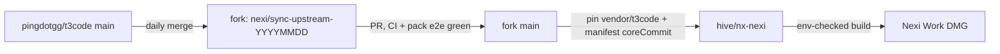

# Upstream sync

How `pingdotgg/t3code` flows into this fork (`johnnyelwailer/t3code`) and from here into the nexi-work pack (`hive/nx-nexi`). These rules are binding for humans and agents.

## Flow

1. **Dated sync branch.** Upstream main is merged into `nexi/sync-upstream-YYYYMMDD` on the fork, never directly into fork `main`.
   - Tooling: `scripts/t3team-sync-upstream-fork.mjs` (logic in `scripts/lib/sync-upstream-core.mjs`; commands `sync-main`, `rebase-current`, `verify-current`).
   - The `upstream` remote must point at `pingdotgg/t3code`. Never push to it.
2. **Cadence.** One batch per day at ~05:48 Europe/Zurich, so results are ready at the start of the workday. Ad-hoc runs only when something urgent lands upstream.
3. **PR, then merge.** The sync goes up as a PR on the fork and merges only when CI is green and the end-to-end check with the full nexi-work pack passes.
4. **Pin in hive only.** After the merge, pin `hive/nx-nexi`: bump the `vendor/t3code` submodule and `nexi-work/manifest.json` `coreCommit` together. `pj/nexi-distribution` is read-only; no pins or sync issues there.

## Merge rules

5. **Additive fork.** Fork code lives in `t3team-*` / `t3team.` files. Upstream files may only be modified if listed in [`docs/t3team-additive-whitelist.md`](../t3team-additive-whitelist.md). `node t3team-additive-guard.mjs` must pass with no new findings compared to `main`.
6. **Conflicts.**
   - Both sides changed a file: take upstream's new structure and re-apply the fork's extension points on top. Read `:1:` (base), `:2:` (fork), `:3:` (upstream).
   - Fork-only `t3team-*` files: keep the fork's version.
   - Upstream-only new files: take upstream's.
   - Dependencies last (`package.json`s, `pnpm-lock.yaml`, `pnpm-workspace.yaml`): take upstream's versions and keep fork-only workspaces/packs.
7. **Event-sourced core gets the most scrutiny**: `apps/server/src/orchestration/{decider,projector,Normalizer,ThreadSettlementReactor}.ts`, `Layers/{OrchestrationEngine,ProjectionPipeline,ProviderCommandReactor,ProviderRuntimeIngestion}.ts`, `Services/ProjectionSnapshotQuery.ts`, `apps/server/src/persistence/Migrations.ts`, `persistence/Layers/ProjectionThreads.ts`, `ProjectionThreadMessages.ts`. A real judgment call there stops the sync for review. Never guess.
8. **No fork regressions.** If an upstream feature makes a fork feature redundant, merge them and keep everything extra the fork had.
9. **Upstream-vs-fork overlaps are the owner's decision.** Example: `show_widget` vs upstream's HTML render tool. The sync stops and asks the owner (Phil) with concrete options. It never decides, never proposes a plan as decided, and never files a decided issue first.

## Verification

10. **Guard baseline.** Capture `t3team-additive-guard.mjs` findings on a clean `origin/main` first; report only new findings.
11. **Typecheck and tests.**
    - Typecheck: `pnpm -C apps/server typecheck`, `pnpm -C apps/web typecheck` (plus `packages/*` that have one).
    - Tests run one package at a time, never in parallel: `packages/shared`, `packages/contracts`, `packages/client-runtime`, `apps/server`, `apps/web`.
    - A failing test is re-run on pre-merge `main` to separate pre-existing failures from merge regressions. Only regressions block.
    - Exit code 137 means the process ran out of memory, not a test failure. Re-run that package alone.
12. **Pack end-to-end.** Run the full nexi-work pack against a copy of real local data, never the live user database.

## Build and DMG

13. **Build env from repo secrets.** The build needs all ten keys and fails on any empty one:
    `VITE_ATLASSIAN_CLIENT_ID`, `T3WORK_ATLASSIAN_CLIENT_ID`, `T3WORK_ATLASSIAN_CLIENT_SECRET`, `T3WORK_TEMPO_CLIENT_ID`, `T3WORK_TEMPO_CLIENT_SECRET`, `T3CODE_CLERK_PUBLISHABLE_KEY`, `T3CODE_CLERK_JWT_TEMPLATE`, `T3CODE_CLERK_CLI_OAUTH_CLIENT_ID`, `T3CODE_RELAY_URL`, `T3CODE_NEXI_BROKER_URL`.
    Never print values; report key names only.
14. **Before handing over a DMG**: the baked `VITE_ATLASSIAN_CLIENT_ID` must match the last good build, and Jira sign-in is smoke-tested.

## Housekeeping

15. Track bigger sync topics as issues in `hive/nx-nexi`.
16. Every GHE comment, review or issue body posted by a bot under a person's account starts with 🤖.
