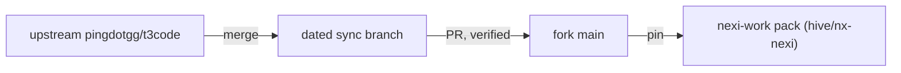

# Upstream sync

How `pingdotgg/t3code` flows into this fork and from here into the nexi-work pack. Binding for humans and agents.

## Principles

1. **Upstream is the base, the fork is additive.** Fork code lives in `t3team-*` / `t3team.` files. Upstream files are modified only when listed in [`docs/t3team-additive-whitelist.md`](../t3team-additive-whitelist.md), enforced by `t3team-additive-guard.mjs`.
2. **Never sync straight into main.** Upstream is merged into a dated sync branch, reviewed and verified as a PR, then merged.
3. **Stay close to upstream.** Sync often, in batches, so conflicts stay small. Never push to the upstream remote.
4. **No fork regressions.** If an upstream feature makes a fork feature redundant, merge the two and keep everything extra the fork had.
5. **Overlaps are an owner decision.** When upstream ships something that collides with a fork feature, the sync stops and the owner chooses between concrete options. Agents never decide this, and never present a plan as already decided.

## Resolving conflicts

6. Both sides changed a file: take upstream's new structure and re-apply the fork's extension points on top.
7. Fork-only files keep the fork's version; upstream-only new files are taken as they are.
8. Dependencies: take upstream's versions and keep fork-only workspaces and packs.
9. The event-sourced core (orchestration decider, projector, engine, projection pipeline, persistence migrations) gets the most scrutiny. A real judgment call there stops the sync for review. Never guess.

## Verification

10. The additive guard shows no new findings compared to `main`.
11. Typecheck passes. Test failures are re-checked on pre-merge `main` so only real merge regressions block.
12. The merged fork is verified end-to-end with the full nexi-work pack, against a copy of real data, never live user data.

## Into the pack

13. The pack pins one fork commit: the `vendor/t3code` submodule and the manifest `coreCommit` move together. The core is never patched inside the pack.
14. Builds take their configuration from repository secrets and fail on any missing value. A build is handed over only after its runtime configuration has been checked against the last good build and sign-in works.
