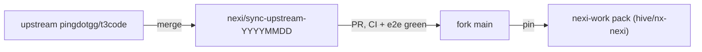

# Upstream sync

How the fork (`johnnyelwailer/t3code`) takes in upstream `pingdotgg/t3code`. The rules are
numbered so they can be cited in reviews and sync PRs ("rule 9 applies here"). The sync is
recurring work, not a one-off: nothing here depends on a particular date, machine, or branch.

For the merge mechanics (worktree, seam files, serial regression run), follow the
`merge-upstream` skill in `.claude/skills/merge-upstream/SKILL.md`.

## Flow

1. **Dated branch, never straight into main.** Upstream `pingdotgg/t3code` `main` is merged into
   a dated branch on the fork, `nexi/sync-upstream-YYYYMMDD`, never directly into fork `main`.
   The tooling is [`scripts/t3team-sync-upstream-fork.mjs`](../../scripts/t3team-sync-upstream-fork.mjs),
   with its logic in [`scripts/lib/sync-upstream-core.mjs`](../../scripts/lib/sync-upstream-core.mjs).
   The `upstream` remote must point at `pingdotgg/t3code`, and nobody ever pushes to it.
2. **Cadence.** One to three batches a day.
3. **The sync is a PR on the fork.** It merges only when CI is green **and** the end-to-end
   check with the full `nexi-work` pack passes (see [Verification](#verification)).
4. **Pin after merge.** Once merged, the pack gets pinned in `hive/nx-nexi`, the only place pins
   go (`pj/nexi-distribution` is read-only). A pin bumps the `vendor/t3code` submodule and
   `nexi-work/manifest.json` `coreCommit` together.

## Merge rules

5. **The fork stays additive.** New code lives in `t3team-*` / `t3team.` files. Upstream files may
   only be changed if they are listed in
   [`docs/t3team-additive-whitelist.md`](../t3team-additive-whitelist.md), and
   `node t3team-additive-guard.mjs` must pass with nothing new compared to `main`.
6. **Who wins a conflict.** Where both sides changed a file, upstream's new structure wins and the
   fork's extension points are re-applied on top. Files that exist only in the fork keep the
   fork's version. New upstream files are taken as they are.
   Dependencies: take upstream's versions and keep fork-only workspaces and packs.
7. **Event-storing core gets the most scrutiny.** Core files that store events (decider,
   projector, `OrchestrationEngine`, `ProjectionPipeline`, migrations, and the like) get the
   closest review. Any real judgment call there stops the sync for review instead of being
   guessed.
8. **No fork regressions.** When an upstream feature makes a fork feature redundant, merge the two
   and keep anything extra the fork had.
9. **Overlaps are always a user call.** Overlaps between upstream and the fork (for example
   `show_widget` vs upstream's HTML rendering) are decided by the user, never by the sync. The
   sync stops and asks with concrete options. It never decides, and never files an already
   decided issue first.
10. **Dig for what file overlap can't show.** Not every regression or overlapping feature is
    detectable purely by touched files. Dig deeper to catch all possible problems by thinking like
    a user, from a UX perspective: walk the affected flows the way a person would, not only the
    diff.

## Verification

10. **(continued) Guard baseline.** Capture the additive guard's findings on `main` first, and
    report only the _new_ findings from the sync branch.
11. **Typecheck, then tests one at a time.** Typecheck server and web, then run the test suites
    one at a time, never in parallel. A failing test is re-run on `main` to separate an old
    failure from a merge regression. Exit code `137` means the process ran out of memory, not
    that the test failed; re-run it serially before triaging.
12. **End-to-end with the pack, on a copy of data.** Then run the end-to-end check with the pack
    against a copy of real local data, never the live database. See
    [Test data](../../AGENTS.md#test-data) for how to make the copy.

## Build and DMG

The DMG is the macOS installer.

13. **All 10 build keys are required.** They come from repo secrets, and the build fails if any
    is empty:
    - `VITE_ATLASSIAN_CLIENT_ID`
    - `T3WORK_ATLASSIAN_CLIENT_ID`
    - `T3WORK_ATLASSIAN_CLIENT_SECRET`
    - `T3WORK_TEMPO_CLIENT_ID`
    - `T3WORK_TEMPO_CLIENT_SECRET`
    - `T3CODE_CLERK_PUBLISHABLE_KEY`
    - `T3CODE_CLERK_JWT_TEMPLATE`
    - `T3CODE_CLERK_CLI_OAUTH_CLIENT_ID`
    - `T3CODE_RELAY_URL`
    - `T3CODE_NEXI_BROKER_URL`
14. **Before any DMG is handed over.** The baked-in Atlassian client ID must match the last good
    build, and Jira sign-in gets a quick smoke test.

## Housekeeping

15. **Issues and bot posts.** Bigger sync topics go in as issues on `hive/nx-nexi`. GHE posts made
    by bots start with 🤖.
